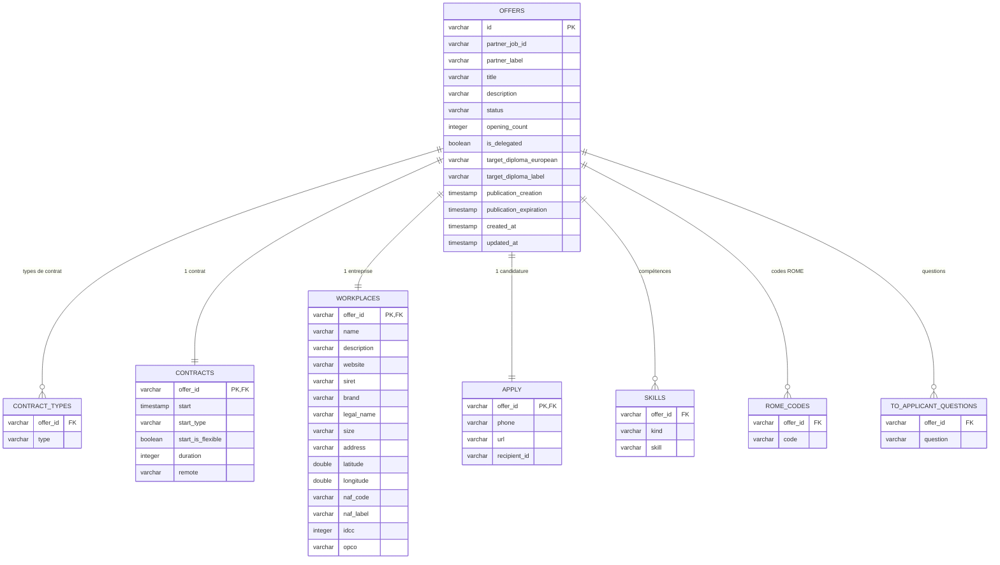

# Architecture — DuckDB (approche relationnelle)

## Principe

L'approche relationnelle **normalise** le document JSON de l'API en tables liées par
clés primaires / étrangères. L'offre est l'entité centrale ; ses listes (compétences,
codes ROME, questions) et ses objets imbriqués (contrat, entreprise, candidature) sont
répartis dans des tables dédiées.

La base est un **fichier local** (`data/alternance.duckdb`) géré par la bibliothèque
`duckdb` (base embarquée, type OLAP, aucune installation serveur).

## Schéma relationnel

## Détail des tables

### `offers` — table principale

Une ligne par offre. Contient les champs scalaires et les métadonnées.

| Colonne | Type | Source API |
|---|---|---|
| `id` | VARCHAR (PK) | `identifier.id` \| `partner_job_id` |
| `partner_job_id` | VARCHAR | `identifier.partner_job_id` |
| `partner_label` | VARCHAR | `identifier.partner_label` |
| `title` | VARCHAR | `offer.title` |
| `description` | VARCHAR | `offer.description` |
| `status` | VARCHAR | `offer.status` |
| `opening_count` | INTEGER | `offer.opening_count` |
| `is_delegated` | BOOLEAN | `is_delegated` |
| `target_diploma_european` | VARCHAR | `offer.target_diploma.european` |
| `target_diploma_label` | VARCHAR | `offer.target_diploma.label` |
| `publication_creation` | TIMESTAMP | `offer.publication.creation` |
| `publication_expiration` | TIMESTAMP | `offer.publication.expiration` |
| `created_at` / `updated_at` | TIMESTAMP | interne (horodatage) |

### `contracts` et `contract_types`

Le contrat (1:1 avec l'offre) est dans `contracts` ; la liste `contract.type` (1:n) est
dans `contract_types` (une ligne par type : "Apprentissage", "Professionnalisation"…).

### `workplaces`

L'entreprise et son lieu : nom, SIRET, adresse, géolocalisation (latitude/longitude),
NAF (code + label), IDCC, OPCO. Les sous-objets imbriqués sont "aplatis" en colonnes.

### `apply`

Les moyens de candidature : URL, téléphone, identifiant destinataire.

### `skills`

Les listes de compétences sont modélisées avec un discriminant `kind` :
- `desired` → `offer.desired_skills`
- `acquired` → `offer.to_be_acquired_skills`
- `access` → `offer.access_conditions`

### `rome_codes` et `to_applicant_questions`

Listes 1:n simples : une ligne par code ROME / par question.

## Opérations

- **Écriture** : `upsert_offer()` — `INSERT ... ON CONFLICT (id) DO UPDATE` puis
  réécriture des lignes liées (DELETE + INSERT) pour rester cohérent.
- **Lecture** : `get_offer()` reconstruit le JSON imbriqué via des requêtes sur les
  tables liées ; `list_offers()` renvoie une vue aplatie pour la liste web.
- **Recherche** : filtre `LIKE` sur `offers.title`.

## Limites de l'approche (observées)

- L'ordre des listes (compétences, ROME) n'est pas préservé (les lignes sont lues
  triées) — il faut un ordre explicite si l'ordre source compte.
- La reconstruction du document imbriqué demande plusieurs requêtes (N+1 si on le fait
  offre par offre).
