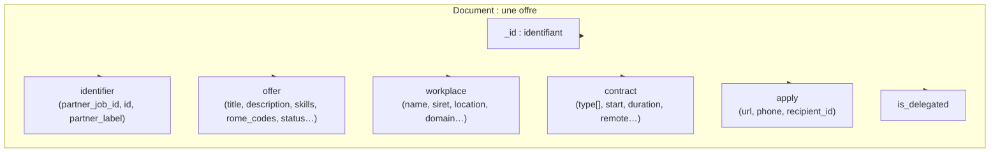

# Architecture — MongoDB (approche documentaire)

## Principe

L'approche documentaire **stocke chaque offre telle quelle**, dans sa structure JSON
imbriquée d'origine. Un document correspond à une offre complète — pas de jointures,
pas de normalisation. Le document est **auto-descriptif** et fidèle à la réponse API.

La base est servie par un conteneur Docker (`mongo:7`), accessible via `mongodb://localhost:27017`,
base `alternance`, collection `job_offers`.

## Modèle documentaire



### Exemple (abrégé)

```json
{
  "_id": "60d2f5a0e8c1a20001a1b2c3",
  "identifier": {
    "partner_job_id": "mock-dev-python-001",
    "id": "60d2f5a0e8c1a20001a1b2c3",
    "partner_label": "LBA"
  },
  "offer": {
    "title": "Développeur / Développeuse Python en alternance",
    "description": "…",
    "desired_skills": ["Faire preuve d'autonomie", "…"],
    "rome_codes": ["M1805", "M1806"],
    "status": "Active",
    "publication": { "creation": "…", "expiration": "…" }
  },
  "workplace": {
    "name": "TechCorp Solutions",
    "siret": "12345678901234",
    "location": { "address": "…", "geopoint": { "type": "Point", "coordinates": [4.8357, 45.764] } },
    "domain": { "idcc": 1486, "opco": "OPCO 2i", "naf": { "code": "62.01Z", "label": "…" } }
  },
  "contract": { "type": ["Apprentissage"], "duration": 12, "remote": "hybrid" },
  "apply": { "url": "…", "phone": "…" },
  "is_delegated": false
}
```

## Choix de conception

- **`_id` = identifiant de l'offre** (`identifier.id`, sinon `partner_job_id`) → upsert
  déterministe via `replace_one({"_id": …}, doc, upsert=True)`.
- **Pas de transformation** : le document est la sérialisation directe du modèle Pydantic
  (`model_dump(mode="json")`). Fidélité maximale avec la source.
- **Index** : index simple sur `identifier.partner_job_id` ; la recherche par titre utilise
  un `$regex` sur `offer.title` (l'indexation texte peut être ajoutée si le volume croît).

## Opérations

- **Écriture** : `upsert_many()` → `bulk_write` de `ReplaceOne` (upsert), insensible à
  la duplication d'offres entre les pages de l'API.
- **Lecture** : `get_offer()` → `find_one({"_id": …})` (le document est déjà complet) ;
  `list_offers()` → `find().sort(...).skip(...).limit(...)` avec projection de la forme
  "liste".
- **Recherche** : `$regex` case-insensitive sur `offer.title`.

## Avantages de l'approche (observés)

- **Zéro jointure** : le détail complet d'une offre est disponible en une seule lecture.
- **Fidélité source** : aucune perte d'information ni de structure (ordre des listes
  préservé).
- **Schéma flexible** : l'ajout de nouveaux champs par l'API ne casse rien.
- **Écriture simple** : pas de réécriture multi-tables pour rester cohérent.

## Points d'attention

- Les requêtes de recherche dites "relationnelles" (compter par ROME, agréger…) restent
  possibles (`aggregate`) mais sont moins naturelles que le SQL.
- Nécessite un serveur (Docker) ; la cohérence et les index sont à maintenir côté serveur.
