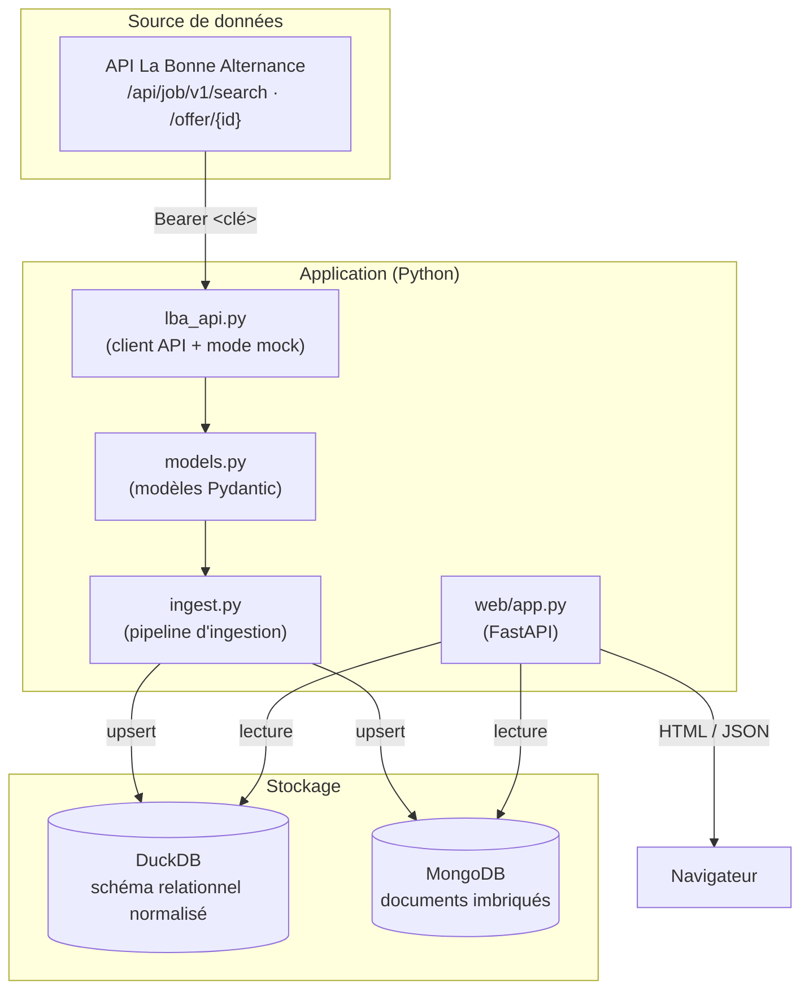

# Architecture

## Vue d'ensemble

Le projet collecte les offres d'emploi en alternance depuis l'API publique
[La Bonne Alternance](https://api.apprentissage.beta.gouv.fr) et les stocke dans **deux
bases de données de paradigmes différents** afin de comparer les approches relationnelle
et documentaire :

- **DuckDB** — base relationnelle embarquée (fichier local), schéma normalisé.
- **MongoDB** — base documentaire, chaque offre est un document JSON imbriqué.

Une application web **FastAPI** permet de consulter les offres (liste et détail) en
basculant d'un backend à l'autre.

## Schéma d'architecture



## Composants

| Module | Rôle | Détails |
|---|---|---|
| `lba_api.py` | Client HTTP de l'API LBA | `search()`, `get_offer()`, `export()` ; retries + backoff ; mode mock si pas de clé |
| `models.py` | Modèles Pydantic | Structure `JobOfferRead` : `identifier`, `workplace`, `apply`, `contract`, `offer`, `is_delegated` |
| `ingest.py` | Pipeline d'ingestion | Lit les offres (API ou mock) et les écrit dans les **deux** bases (upsert) |
| `storage/duckdb_store.py` | Accès relationnel | Schéma normalisé, clés primaires/étrangères |
| `storage/mongo_store.py` | Accès documentaire | Collection `job_offers`, documents complets, `_id` = identifiant |
| `web/app.py` | API web FastAPI | Routes liste / détail / health, backend commutable |

## Flux de données

### Ingestion

```
API LBA ──▶ lba_api.search() ──▶ JobOffer[] (Pydantic)
                                    │
                                    ├──▶ DuckDBStore.upsert_many()  (tables normalisées)
                                    └──▶ MongoStore.upsert_many()   (documents complets)
```

L'identifiant d'une offre = `identifier.id`, sinon `partner_job_id`. C'est la clé
d'adressage commune aux deux bases.

### Consultation

```
Navigateur ──▶ FastAPI /  (backend=duckdb|mongo)
                  │
                  ├──▶ DuckDBStore.list_offers() / get_offer()
                  └──▶ MongoStore.list_offers() / get_offer()
                  │
                  └──▶ templates Jinja2 (liste + détail) ou JSON
```

## Choix d'identifiant

- **DuckDB** : colonne PK `id` (VARCHAR) + FK dans les tables liées.
- **MongoDB** : champ `_id` = identifiant de l'offre, unique.

Les deux bases répondent aux mêmes routes avec le même identifiant, ce qui permet de
comparer les implémentations à données équivalentes.

## Références

- [Modèle relationnel DuckDB](architecture-duckdb.md)
- [Modèle documentaire MongoDB](architecture-mongodb.md)
- [Comparaison des deux approches](comparaison.md)
- [Décisions d'architecture (ADR)](decisions.md)
