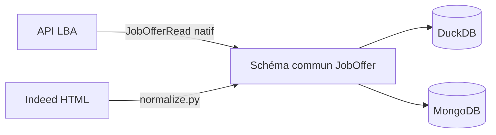

# Sources de données & normalisation

Le projet ingère des offres d'alternance depuis **plusieurs sources**, normalisées vers un
**schéma commun** (`JobOffer`, structure `JobOfferRead`) avant stockage dans DuckDB et
MongoDB. Ceci garantit que les offres de toutes les sources sont **compatibles** entre
elles (mêmes champs, mêmes types, mêmes contraintes).

## Sources disponibles

| Source | Module | Endpoint / méthode | Champs disponibles |
|---|---|---|---|
| **API La Bonne Alternance (LBA)** | `lba_api.py` | `GET /api/job/v1/search`, `/offer/{id}` | Complets (identifier, workplace, contract, offer, apply, ROME…) |
| **Indeed (scraping)** | `scrapers/indeed.py` | HTML `/emplois`, `/viewjob` | Titre, entreprise, lieu, description, contrat, salaire… |

## Principe de normalisation

Chaque source produit des `JobOffer` (modèle Pydantic). L'ingestion (`ingest.py`) ne
connaît que ce modèle, quelle que soit la source.

## Correspondance Indeed → JobOfferRead

| Champ `JobOffer` | Source Indeed | Remarques |
|---|---|---|
| `identifier.partner_label` | — | forcé à `"Indeed"` |
| `identifier.partner_job_id` | `data-jk` (clé d'offre) | identifiant unique Indeed |
| `identifier.id` | — | `None` → `JobOffer.id` = `partner_job_id` |
| `offer.title` | `h2.jobTitle` | — |
| `offer.description` | `#jobDescriptionText` | page de détail (viewjob) |
| `offer.status` | — | forcé à `"Active"` |
| `offer.opening_count` | — | forcé à `1` |
| `offer.rome_codes` | — | **non fourni** → `[]` (champ requis LBA) |
| `offer.desired_skills` / `to_be_acquired_skills` / `access_conditions` | — | non extraits → `[]` |
| `offer.publication.creation` | `span.date` (relatif) | converti en date ISO via `parse_date_text()` |
| `contract.type` | libellés (`Alternance`, `Professionnalisation`…) | mappés vers l'enum LBA `["Apprentissage","Professionnalisation"]` |
| `contract.remote` | libellé (`Hybride`, `Télétravail`…) | mappé vers `hybrid` / `remote` / `onsite` |
| `contract.start` / `duration` | — | `None` (non fourni par Indeed) |
| `workplace.name` | `span.companyName` | — |
| `workplace.location.address` | `[data-testid="text-location"]` | — |
| `workplace.siret` / `domain` | — | `None` (non exposé dans le HTML public) |
| `apply.url` | `/viewjob?jk=<clé>` | URL de la fiche Indeed |
| `apply.phone` / `recipient_id` | — | `None` |
| `is_delegated` | — | `False` |

## Mappages de valeurs

### Types de contrat

Les libellés Indeed sont traduits vers l'enum LBA `contract.type` :

| Libellé Indeed | `contract.type` (LBA) |
|---|---|
| `Alternance` / `Apprentissage` | `["Apprentissage"]` |
| `Professionnalisation` / `Contrat pro` | `["Professionnalisation"]` |
| autres (CDI, CDD, Stage…) | `[]` |

### Modalité de travail

| Libellé Indeed | `contract.remote` (LBA) |
|---|---|
| `Hybride` / `Hybrid` | `hybrid` |
| `Télétravail` / `Remote` / `À distance` | `remote` |
| `Sur site` / `Présentiel` / `En présentiel` | `onsite` |

### Dates relatives

Les dates relatives françaises sont converties en date ISO (`YYYY-MM-DD`) :
`Aujourd'hui`, `Hier`, `Il y a N jours`, `Il y a N semaines`, `Il y a N mois`, `Depuis N jours`.

## Limites & compatibilité

- **Champs non fournis par Indeed** sont mis à leur valeur neutre (`[]`, `None`, `1`) pour
  satisfaire les champs requis du schéma LBA. Les offres restent valides et stockables.
- **Codes ROME absents** : les offres Indeed ne sont pas filtrables par ROME. À terme, une
  correspondance titre → ROME pourrait être ajoutée.
- **robots.txt / anti-bot** : Indeed interdit le scraping automatique (`/emploi/`,
  `/viewjob`) et bloque les requêtes directes (HTTP 403). Le scraping en direct peut donc
  échouer ; le parsing est couvert par des fixtures de test.
